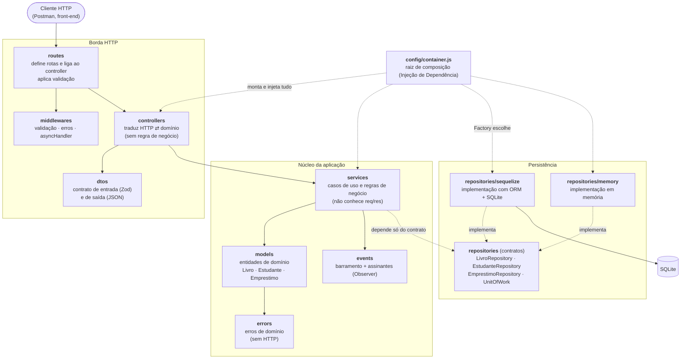
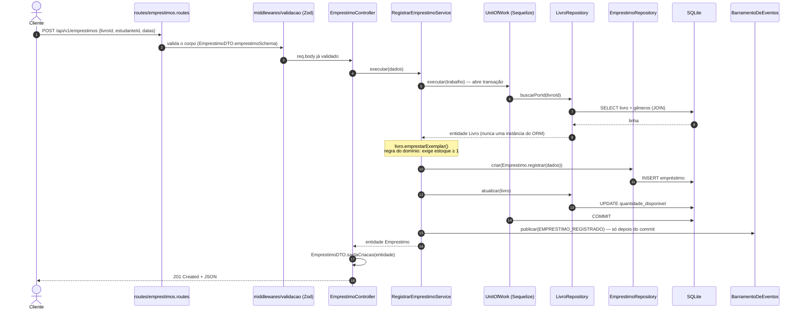

# Arquitetura — API da Biblioteca Escolar (Trabalho 3)

> A API **não mudou para quem a consome** (mesmas rotas, mesmos status, mesmos JSONs);
> mudou para quem a **mantém**. Este documento explica como o código está organizado e *por quê*.

## 1. Estilo, padrão e padrões de projeto (três conceitos diferentes)

| Conceito | O que é | O que usamos aqui |
|---|---|---|
| **Estilo arquitetural** | Visão de mais alto nível sobre como o sistema se comunica | **Cliente-servidor + REST** (a API HTTP) |
| **Padrão arquitetural** | Como organizar o código de *uma* aplicação | **Arquitetura em camadas + MVC** |
| **Padrões de projeto** | Soluções para problemas pontuais de design | Repository, Injeção de Dependência, Factory, DTO, Observer, Unit of Work, Singleton |

No MVC desta API: **Model** = entidades de domínio (`src/models`) + regras (`src/services`);
**View** = a representação JSON produzida pelos DTOs de saída (`src/dtos`);
**Controller** = `src/controllers`.

## 2. Diagrama das camadas



**A regra de dependência aponta sempre para dentro:** o domínio (`models`, `errors`) não importa nada
de Express nem do ORM; os serviços dependem de *contratos* de repositório, nunca de uma
implementação concreta. Essa regra não depende da disciplina da equipe — ela é **verificada
automaticamente** (seção 7).

## 3. Responsabilidade de cada camada

| Camada | Responsabilidade | Pode importar | **Não** pode |
|---|---|---|---|
| `routes` | Declarar rotas e ligá-las ao controlador; encadear validação | `middlewares`, `dtos`, `express` | conhecer serviços, repositórios ou ORM |
| `controllers` | Traduzir HTTP ⇄ domínio: ler a requisição, chamar **um** caso de uso, escrever a resposta | `dtos` | conter regra de negócio; falar com repositório; importar ORM |
| `services` | Regras de negócio e orquestração dos casos de uso | `models`, `errors`, `events` | conhecer `req`/`res`/Express; importar repositório concreto ou ORM; instanciar colaboradores |
| `models` | Representar o domínio e suas invariantes (ex.: "não se empresta sem exemplar") | `errors` | depender de qualquer outra camada |
| `errors` | Dizer *o que* deu errado em termos do domínio | — | conhecer HTTP |
| `dtos` | Contrato de entrada (validação Zod) e de saída (formato do JSON) | `zod` | conter regra de negócio |
| `events` | Publicar/assinar fatos de domínio | — | conhecer quem assina |
| `repositories` (contratos) | Declarar *o que* a aplicação precisa da persistência, em termos de entidades | `models`, `errors` | expor tipos do ORM nas assinaturas |
| `repositories/sequelize` | Implementar os contratos com Sequelize/SQLite; traduzir erros do banco | `models`, `errors`, ORM | — (**é a única** camada que pode importar o ORM) |
| `repositories/memory` | Implementar os mesmos contratos em memória | `models`, `errors` | — |
| `middlewares` | Preocupações transversais: validação, erros (`tratadorDeErros`), `asyncHandler` | `errors`, `zod` | — |
| `config` | Raiz de composição (DI), leitura de ambiente, logger | tudo | ser importada por outras camadas |

## 4. Fluxo completo de uma requisição

Exemplo: `POST /api/v1/emprestimos` (a operação mais rica: valida, consulta, aplica regra, grava em transação e notifica).



**Caminho de erro** (ex.: livro sem exemplares): `livro.emprestarExemplar()` lança
`LivroIndisponivelError` → a Unit of Work faz **ROLLBACK** → o erro sobe pelo `asyncHandler` →
`tratadorDeErros` converte `tipo: CONFLITO` em **409** com o corpo padronizado
`{ "erro": { "codigo": "LIVRO_INDISPONIVEL", "mensagem": "..." } }`. Nenhum evento é publicado.

## 5. Padrões de projeto aplicados — o problema real, e o que teria acontecido sem eles

Cada padrão abaixo responde a uma **dor concreta do código do Trabalho 2**. Padrão sem problema é enfeite.

### 5.1 Repository *(obrigatório)*
- **Problema no T2:** os controllers chamavam funções que devolviam instâncias do Sequelize
  (`res.json(estudante)`), e os "repositórios" lançavam `ApiError` — uma classe HTTP dentro da
  persistência. O formato do JSON dependia de acidentes do ORM (ex.: `POST /estudantes` não trazia
  `deletedAt`, mas `GET` trazia `deletedAt: null`).
- **O que teria acontecido sem ele:** trocar o ORM (ou só atualizá-lo) quebraria controllers e regras;
  qualquer teste de regra de negócio exigiria um banco real.
- **Como ficou:** contratos em `src/repositories/*Repository.js` falam apenas em entidades de
  domínio; `repositories/sequelize` implementa e traduz erros do banco para erros da aplicação.

### 5.2 Injeção de Dependência *(obrigatório)*
- **Problema no T2:** controllers faziam `require('../repositories/...')` direto — acoplamento
  fixo à implementação, impossível de trocar ou simular.
- **O que teria acontecido sem ela:** os serviços teriam de dar `new SequelizeLivroRepository()`,
  amarrando a regra de negócio ao banco; testar `RegistrarEmprestimoService` sem SQLite seria impossível.
- **Como ficou:** todo serviço recebe seus colaboradores **pelo construtor**; só `config/container.js`
  usa `new` para compor as peças. O teste de arquitetura garante que serviços e controllers não
  instanciam colaboradores. Prova viva: `tests/unit/casosDeUso.test.js` monta serviços com
  persistência em memória e até com um repositório "fake" escrito à mão em poucas linhas.

### 5.3 Factory
- **Problema:** é preciso escolher entre duas famílias de implementações (banco real ou memória)
  *conforme a configuração*, sempre combinando peças compatíveis (3 repositórios + Unit of Work).
- **O que teria acontecido sem ela:** um `if (driver === ...)` espalhado pelo container, com risco de
  misturar um repositório Sequelize com uma Unit of Work em memória (erro silencioso).
- **Como ficou:** `criarPersistencia({ driver })` devolve o conjunto coerente; `REPOSITORY_DRIVER=memory`
  troca tudo de uma vez.

### 5.4 DTO (entrada e saída)
- **Problema no T2:** o contrato da API era "o que o ORM devolvia"; validação e formato estavam misturados.
- **O que teria acontecido sem ele:** renomear uma coluna alteraria o JSON público sem ninguém perceber.
- **Como ficou:** `src/dtos` define explicitamente o que entra (schemas Zod) e o que sai
  (`saida`, `saidaCriacao`, `saidaComLivro`). A entidade pode evoluir sem mudar a API.

### 5.5 Observer *(bônus)*
- **Problema:** "notificar após registrar/devolver um empréstimo" não pode virar mais uma linha dentro do
  caso de uso (que passaria a conhecer e-mail, SMS, log...).
- **O que teria acontecido sem ele:** `RegistrarEmprestimoService` acumularia responsabilidades e
  uma falha na notificação poderia derrubar um empréstimo já gravado.
- **Como ficou:** o serviço **publica** `emprestimo.registrado`; `NotificarEmprestimoListener` **assina**.
  O evento só sai *depois do commit*, e o erro de um assinante é isolado (testado).

### 5.6 Unit of Work *(não está na lista do enunciado, mas resolve uma dor real)*
- **Problema:** "registrar empréstimo + baixar estoque" precisa ser atômico, mas o serviço não pode conhecer
  `sequelize.transaction` (violaria a regra de dependência). No T2, essa regra de negócio *estava dentro do repositório*.
- **O que teria acontecido sem ela:** ou a regra de negócio ficaria presa no repositório (como no T2),
  ou o ORM vazaria para o serviço.
- **Como ficou:** `unitOfWork.executar(async ({ livros, emprestimos }) => ...)` entrega repositórios
  ligados à mesma transação (commit se resolver, rollback se lançar). Há versão em memória com rollback
  por *snapshot*, testada.

### 5.7 Singleton *(com parcimônia — só na conexão)*
- **Problema:** cada instância do Sequelize abre um pool; no SQLite, várias conexões geram `database is locked`.
- **O que teria acontecido sem ele:** uma conexão por repositório/requisição.
- **Como ficou:** `repositories/sequelize/conexao.js` mantém **uma** conexão por processo (módulo com estado
  preguiçoso + `encerrarConexao()` para testes e *graceful shutdown*). **Não** usamos Singleton para mais nada.

### 5.8 O que deliberadamente NÃO foi aplicado
- **Strategy:** não há, hoje, nenhuma regra que *varie* (multa, desconto, formato de exportação). Criar uma
  seria superengenharia. Quando surgir cálculo de multa por atraso, esse é o lugar natural.
- **Framework de DI / decorators:** a composição manual em `container.js` tem poucas dezenas de linhas e é totalmente legível;
  um container com reflexão adicionaria magia sem resolver dor alguma neste tamanho de projeto.

## 6. Preservação do comportamento (refatoração segura)

A garantia de que "a API não mudou" não é declaratória — é executável, em **três camadas de prova**:

1. **Golden master:** `tests/golden/sequencia.js` define 88 requisições (todos os endpoints, filtros, ordenações,
   erros 400/404/409, transações). Ela foi executada **contra o código original do Trabalho 2**, e o status +
   corpo de cada resposta foi gravado em `comportamento-trabalho2.json`. `tests/preservacao.test.js` reexecuta a
   sequência na arquitetura nova e exige igualdade **campo a campo**.
2. **Os 28 testes HTTP do T2**, portados **sem alterar nenhuma asserção** (`tests/api`).
3. **Coleção do Postman** (`postman_collection.json`, 88 requisições / 171 asserções) executada pelo Newman
   (`npm run test:postman`).

Tudo isso roda com **os dois drivers** de persistência (`npm test` e `npm run test:memoria`).

### Comportamentos legados preservados de propósito
Refatorar é mudar a estrutura *sem* mudar o comportamento. Estes pontos do T2 parecem imperfeições, mas
foram **mantidos** e estão cobertos pelo golden master; corrigi-los é uma mudança de contrato e merece
uma versão própria da API:

| # | Comportamento do T2 (preservado) | Sugestão para uma futura v2 |
|---|---|---|
| 1 | JSON malformado no corpo → `500 ERRO_INTERNO` | Devolver `400` |
| 2 | `GET /livros?genero=x` devolve, em `generos`, **só** o gênero filtrado | Devolver todos os gêneros do livro |
| 3 | `POST /estudantes` não traz `deletedAt`; `POST /emprestimos` não traz `dataDevolucaoReal` | Respostas de criação com o mesmo formato do `GET` |
| 4 | `GET /` ainda diz "Trabalho 2" | Atualizar o texto |
| 5 | `PUT/PATCH` de empréstimo que troque `livroId` não reajusta o estoque | Tratar como regra de domínio |

## 7. Como as regras da arquitetura são impostas

- **ESLint** (`npm run lint`, sem erros nem avisos): proíbe `require('sequelize')` fora de `repositories/sequelize`,
  proíbe repositórios em rotas/controllers/DTOs/domínio, e impede serviços de importar Express, ORM ou camadas superiores.
- **`tests/arquitetura.test.js`**: lê os `require()` de cada arquivo de `src/` e confere a matriz de dependências
  da seção 3, que o ORM só aparece na persistência, que serviços não usam `req`/`res`/Express, que ninguém
  instancia colaboradores fora do `container`, e que **não existe nenhum ciclo** de dependências.
  (Validado por sabotagem deliberada: controller importando repositório, ORM em serviço, ciclo `errors ⇄ models` — todos detectados.)

## 8. Mapa rápido: onde está cada coisa

```
src/
├── server.js                  # sobe o HTTP, encerramento limpo
├── app.js                     # monta o Express a partir de um container
├── config/  (env, logger, container ← Injeção de Dependência)
├── routes/  controllers/  dtos/  middlewares/     # borda HTTP
├── services/  models/  errors/  events/           # núcleo
└── repositories/
    ├── *Repository.js, UnitOfWork.js              # contratos
    ├── criarPersistencia.js                       # Factory
    ├── sequelize/                                 # ORM isolado aqui (+ Singleton da conexão)
    └── memory/                                    # troca de implementação (bônus)
```
