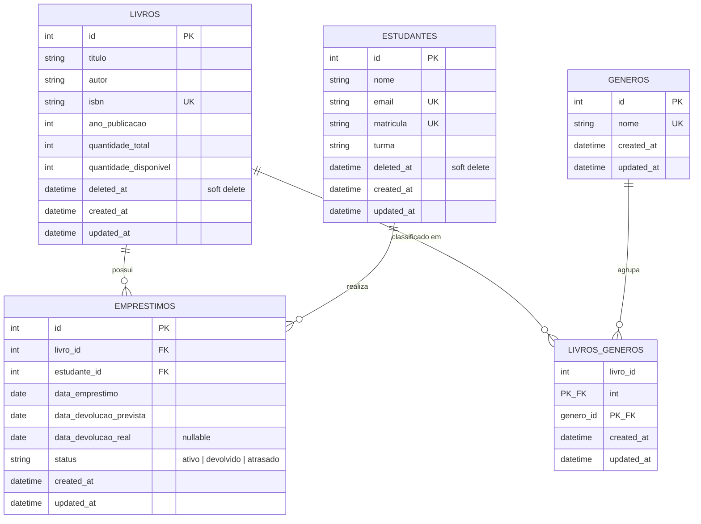

# API REST — Sistema de Biblioteca Escolar

**Trabalho 3 — Estilos e padrões arquiteturais.** Esta é a API do Trabalho 2 **reestruturada**:
arquitetura em camadas com MVC, Repository, Injeção de Dependência, Factory, DTO, Observer e Unit of Work.
**O comportamento externo não mudou** — a API é idêntica para quem a consome (e isso é verificado por
testes, não apenas afirmado). Mudou para quem a mantém.

> 📐 Documentação da arquitetura: [`ARQUITETURA.md`](ARQUITETURA.md) · 🧾 Decisões: [`docs/adr/`](docs/adr)

## Sumário

- [Arquitetura em uma página](#arquitetura-em-uma-página)
- [Decisões arquiteturais e suas justificativas](#decisões-arquiteturais-e-suas-justificativas)
- [Instalação e execução (do zero)](#instalação-e-execução-do-zero)
- [Scripts disponíveis](#scripts-disponíveis)
- [Como sabemos que o comportamento não mudou](#como-sabemos-que-o-comportamento-não-mudou)
- [Trocando a implementação do repositório (demonstração)](#trocando-a-implementação-do-repositório-demonstração)
- [Stack e justificativa](#stack-e-justificativa)
- [Modelagem / Diagrama ER](#modelagem--diagrama-er)
- [Convenções de nomenclatura](#convenções-de-nomenclatura)
- [Migrations](#migrations)
- [Endpoints](#endpoints)
- [Integridade e transações](#integridade-e-transações)
- [Tratamento de erros](#tratamento-de-erros)
- [Estrutura do projeto](#estrutura-do-projeto)
- [Requisitos do trabalho × onde estão atendidos](#requisitos-do-trabalho--onde-estão-atendidos)
- [Refatoração incremental (roteiro de commits)](#refatoração-incremental-roteiro-de-commits)
- [Como a equipe se organizou](#como-a-equipe-se-organizou)

## Arquitetura em uma página

```
HTTP ─► routes ─► controllers ─► services ─► repositories (contratos) ─► implementação (Sequelize | memória)
         │            │              │                                         │
     validação     HTTP⇄domínio   regras de negócio                    ORM isolado aqui
     (Zod/DTO)   (sem regra!)    (sem req/res!)                        (e só aqui)
```

- **Regra de dependência:** aponta sempre para dentro; nenhuma camada pula níveis; serviços não conhecem `req`/`res`.
- **Padrões (cada um justificado no `ARQUITETURA.md` com "o problema" e "o que teria acontecido sem ele"):**
  Repository · Injeção de Dependência · Factory · DTO · Observer · Unit of Work · Singleton (só na conexão).
- **Não aplicamos Strategy** de propósito: ainda não há regra que varie (evitar superengenharia).
- **Regras impostas automaticamente:** ESLint + `tests/arquitetura.test.js` (camadas, ORM só na persistência, **sem dependências circulares**).

## Decisões arquiteturais e suas justificativas

Cada decisão responde a uma dor concreta do código do Trabalho 2 (detalhes em [`ARQUITETURA.md`](ARQUITETURA.md) e nos [ADRs](docs/adr)):

| Decisão | Por quê (o problema no T2) | Detalhe |
|---|---|---|
| **Camadas + MVC**, dependência sempre para dentro | Controllers tinham regra de negócio e conheciam o ORM; nada era testável sem HTTP e banco | [ADR-0001](docs/adr/0001-arquitetura-em-camadas-com-mvc.md) |
| **Repository** com contratos; ORM só em `repositories/sequelize` | Os "repositórios" devolviam instâncias do Sequelize e lançavam erro HTTP (`ApiError`) | [ADR-0002](docs/adr/0002-repository-e-injecao-de-dependencia.md) |
| **Injeção de Dependência** manual (`container.js`) + **Factory** de persistência | Controllers faziam `require` direto dos repositórios: impossível trocar a implementação ou simular em teste | [ADR-0002](docs/adr/0002-repository-e-injecao-de-dependencia.md) |
| **Unit of Work** | A regra "sem exemplar não se empresta" estava misturada com a transação dentro do repositório | [ADR-0003](docs/adr/0003-unit-of-work-para-transacoes.md) |
| **DTO** de entrada e saída | O formato do JSON dependia de acidentes do ORM (ex.: `deletedAt` aparecia no GET, mas não no POST) | [`ARQUITETURA.md` §5.4](ARQUITETURA.md) |
| **Observer** (eventos de domínio) | Notificar não pode contaminar o caso de uso nem fazer uma operação concluída falhar | [ADR-0005](docs/adr/0005-eventos-de-dominio-com-observer.md) |
| **Singleton** só na conexão | Uma instância do ORM = um pool; várias conexões no SQLite causam `database is locked` | [`ARQUITETURA.md` §5.7](ARQUITETURA.md) |
| **Sem Strategy** (decisão consciente) | Hoje nenhuma regra varia; criar um seria superengenharia (penalizada) | [`ARQUITETURA.md` §5.8](ARQUITETURA.md) |
| **Preservar até as imperfeições** + golden master | Refatorar não é corrigir; corrigir muda o contrato e merece versão própria | [ADR-0004](docs/adr/0004-preservar-comportamento-legado-com-golden-master.md) |

## Instalação e execução (do zero)

Pré-requisito: Node.js LTS.

```bash
# 1. Instalar dependências
npm install

# 2. Copiar variáveis de ambiente (o padrão já usa SQLite, nada a configurar)
cp .env.example .env          # no Windows (PowerShell): copy .env.example .env

# 3. Criar as tabelas (migrations) e popular com dados de exemplo (seed)
npm run db:migrate
npm run db:seed

# 4. Subir o servidor
npm run dev                   # com reload automático   (ou: npm start)
```

Servidor em `http://localhost:3000` · Swagger em `http://localhost:3000/docs`.
Para recomeçar do zero: `npm run db:reset`.

## Scripts disponíveis

| Script | O que faz |
|---|---|
| `npm start` / `npm run dev` | Sobe o servidor (`dev` com reload automático) |
| `npm run start:memoria` | Sobe o servidor **sem banco**, com repositórios em memória |
| `npm test` | Todos os testes, com repositórios Sequelize/SQLite (banco de teste recriado do zero) |
| `npm run test:memoria` | **A mesma suíte**, com repositórios em memória |
| `npm run test:postman` | Executa a coleção do Postman com o Newman contra uma instância real |
| `npm run lint` | ESLint (inclui as regras de camada) — deve terminar sem erros nem avisos |
| `npm run verificar` | `lint` + testes (2 drivers) + Postman, tudo de uma vez |
| `npm run db:migrate` / `db:migrate:undo` / `db:seed` / `db:reset` | Banco de dados |

## Como sabemos que o comportamento não mudou

Refatorar é mudar a estrutura **sem** mudar o comportamento — então precisamos de prova. Há três:

1. **Golden master** (`tests/preservacao.test.js`): 88 requisições (todos os endpoints, filtros, ordenações,
   erros 400/404/409, transações) foram executadas contra o **código original do Trabalho 2**; o status e o corpo de
   cada resposta foram gravados em `tests/golden/comportamento-trabalho2.json`. A versão nova precisa responder
   **idêntico, campo a campo**.
2. **Os 28 testes HTTP do Trabalho 2**, portados para `tests/api/` **sem alterar nenhuma asserção**.
3. **Coleção do Postman** (`postman_collection.json`): 88 requisições / 171 asserções, executadas pelo Newman.

Resultado atual: `npm test` e `npm run test:memoria` → **147 testes passando** cada; `npm run test:postman` →
**88/88 requisições, 0 falhas**; `npm run lint` → **0 erros, 0 avisos**.

> **Sobre a coleção do Postman.** A coleção original do Trabalho 1 foi escrita para o contrato do T1 (livro com
> `genero` em texto) e **já não passava no T2**, que passou a exigir `generos` (lista). Por isso o
> `postman_collection.json` deste repositório é a coleção atualizada para o contrato do T2 (mesmos recursos, mais
> casos) e **passa integralmente** (88 requisições, 171 asserções, 0 falhas). Conferimos ainda que a coleção original
> do T1 produz **respostas idênticas (status e corpo) no T2 e no T3** nas 33 requisições dela — ou seja, a refatoração
> não alterou o comportamento nem nos pontos em que a coleção antiga já divergia do T2.

Alguns comportamentos do T2 parecem imperfeições (ex.: JSON malformado → `500`), mas foram **preservados de
propósito** — corrigi-los é mudança de contrato. Estão catalogados em [`ARQUITETURA.md` §6](ARQUITETURA.md) e no
[ADR-0004](docs/adr/0004-preservar-comportamento-legado-com-golden-master.md).

## Trocando a implementação do repositório (demonstração)

A camada de serviço só conhece os **contratos** de repositório. Para provar, a mesma aplicação roda com outra implementação,
**sem alterar nenhum arquivo de `src/services`**:

```bash
npm run start:memoria     # API completa, sem banco (dados de exemplo em memória; somem ao reiniciar)
npm run test:memoria      # a MESMA suíte de testes, agora contra os repositórios em memória
```

A escolha é feita pela variável `REPOSITORY_DRIVER` (`sequelize` | `memory`) na Factory `src/repositories/criarPersistencia.js`.

## Stack e justificativa

| Camada | Escolha |
|---|---|
| SGBD | **SQLite** |
| ORM | **Sequelize** |

**Por que SQLite em vez de PostgreSQL?** O enunciado aceita SQLite desde
que justificado. Optamos por ele porque o banco é um arquivo local
(`data/dev.sqlite3`) — não é preciso instalar, configurar usuário/senha
nem manter um serviço de banco rodando à parte para reproduzir o projeto.
Isso elimina uma fonte comum de erro de ambiente ao rodar/avaliar o
trabalho em máquinas diferentes. A camada de acesso a dados é isolada nos
`repositories/`, então trocar para PostgreSQL depois é uma mudança
pequena: bastaria (1) ajustar `DB_DIALECT`/`DB_HOST`/etc. no `.env` — a
`config/config.js` já está preparada para isso — e (2) trocar os poucos
tipos específicos de SQLite, se houver algum.

**Por que Sequelize em vez de Prisma?** O Prisma precisa baixar um
binário de engine de um CDN próprio (`binaries.prisma.sh`) durante a
instalação; em ambientes com rede restrita (proxies corporativos,
sandboxes, alguns CI) esse download falha e o Prisma não funciona. O
Sequelize depende só do registro do npm e de um driver do banco (aqui,
`sqlite3`), então é mais robusto para configurar em qualquer máquina —
foi inclusive assim que detectamos o problema, ao tentar rodar com Prisma
neste ambiente. O enunciado permite Sequelize como alternativa.

## Modelagem / Diagrama ER

5 tabelas, com um relacionamento **1-N** duplicado (Livro→Empréstimo e
Estudante→Empréstimo) e um relacionamento **N-N** (Livro↔Gênero, via
tabela de junção `livros_generos`):



**Restrições de integridade aplicadas no esquema:**
- `livros.isbn`, `estudantes.email` e `estudantes.matricula` são `UNIQUE`.
- Todos os campos essenciais são `NOT NULL`.
- `livros.quantidade_total`/`quantidade_disponivel` têm valor padrão `0`;
  `emprestimos.status` tem valor padrão `'ativo'`.
- `emprestimos.livro_id`/`estudante_id` são chaves estrangeiras com
  `onDelete: RESTRICT` — o banco recusa a exclusão física de um livro ou
  estudante referenciado por um empréstimo (a aplicação, por cima disso,
  usa **soft delete**, então essa restrição funciona como uma segunda
  camada de proteção).
- `livros_generos.livro_id`/`genero_id` usam `onDelete: CASCADE` (a
  tabela de junção não faz sentido sem as duas pontas).

## Convenções de nomenclatura

- **Banco de dados**: tabelas e colunas em `snake_case` (`ano_publicacao`,
  `quantidade_disponivel`, `livro_id`), no plural para tabelas.
- **Camada de aplicação (JS/JSON)**: `camelCase` (`anoPublicacao`,
  `quantidadeDisponivel`, `livroId`). O Sequelize (`underscored: true` +
  `field:` em cada atributo) faz essa tradução automaticamente — os
  controllers e a API nunca veem `snake_case`.

## Migrations

Duas migrations, em momentos distintos:

1. **`create-initial-schema`** — cria as 5 tabelas, com PKs, FKs, `UNIQUE`,
   `NOT NULL`, valores padrão e índices para as consultas mais frequentes
   (`titulo`, `turma`, `status`, `estudante_id`, `livro_id`).
2. **`add-soft-delete-to-livros-and-estudantes`** — evolução real do
   esquema: adiciona a coluna `deleted_at` em `livros` e `estudantes`
   (bônus de soft delete) mais os índices correspondentes. Gerada depois
   da primeira, sem editar a migration anterior — exatamente como uma
   mudança de escopo aconteceria num projeto real.

Nenhuma tabela foi criada manualmente; tudo passa por
`sequelize-cli db:migrate`.

## Endpoints

Igual ao Trabalho 1 em formato, mas agora resolvidos no banco. Todos sob
`/api/v1`.

### Livros

| Método | Rota | Observação |
|---|---|---|
| GET | `/livros` | Filtros (`genero`, `titulo`, `autor`, `anoPublicacao`, `ano_min`, `ano_max`), ordenação (`ordenar`, `direcao`) e paginação (`page`, `limit`) — tudo via SQL |
| GET | `/livros/:id` | Inclui a lista de `generos` (JOIN) |
| POST | `/livros` | Transacional: cria o livro e associa os gêneros (criando os que não existirem) |
| PUT | `/livros/:id` | Substitui livro + gêneros |
| PATCH | `/livros/:id` | Atualização parcial |
| DELETE | `/livros/:id` | Soft delete; `409` se houver empréstimo ativo |

### Estudantes

| Método | Rota | Observação |
|---|---|---|
| GET | `/estudantes` | Filtros (`turma`, `nome`), ordenação, paginação |
| GET | `/estudantes/:id` | — |
| GET | `/estudantes/:id/emprestimos` | **Endpoint com dados relacionados**: cada empréstimo já vem com o `livro` (id/título/autor) carregado via `include`, sem N+1 |
| POST / PUT / PATCH / DELETE | `/estudantes[/:id]` | Soft delete no DELETE; `409` se houver empréstimo ativo |

### Empréstimos

| Método | Rota | Observação |
|---|---|---|
| GET | `/emprestimos` | Filtros (`status`, `estudanteId`, `livroId`), ordenação, paginação |
| GET | `/emprestimos/:id` | — |
| POST | `/emprestimos` | **Transacional** (ver seção abaixo) |
| PUT | `/emprestimos/:id` | Substitui |
| PATCH | `/emprestimos/:id` | **Transacional** quando muda `status` para `devolvido` |
| DELETE | `/emprestimos/:id` | **Transacional**: repõe o exemplar se o empréstimo estava ativo |

## Integridade e transações

- **Validação de FK antes de criar**: `POST /emprestimos` verifica se o livro e o estudante existem, retornando `404`
  com mensagem específica se não existirem (`RegistrarEmprestimoService`).
- **Impedimento de exclusão que quebraria integridade**: `DELETE /livros/:id` e `DELETE /estudantes/:id` retornam `409`
  se houver empréstimo ativo vinculado (regra em `LivroService`/`EstudanteService`) — e, como segunda camada, a FK do
  banco (`onDelete: RESTRICT`) rejeitaria uma exclusão física indevida.
- **Operações transacionais** via **Unit of Work** (`unitOfWork.executar(...)`): registrar empréstimo + baixar estoque,
  registrar devolução + repor estoque, e remover empréstimo ativo + repor estoque acontecem na **mesma transação**. Se
  qualquer etapa falhar, **nada** é gravado. A regra "não se empresta sem exemplar" vive na entidade `Livro`; o serviço
  não conhece `sequelize.transaction` (ver [ADR-0003](docs/adr/0003-unit-of-work-para-transacoes.md)).
  Cobertura: `tests/api/emprestimos.test.js` e `tests/unit/casosDeUso.test.js` (inclui teste de *rollback*).

## Tratamento de erros

Os erros descrevem o que deu errado **em termos do domínio** (`src/errors/erros.js`), sem conhecer HTTP.
Os repositórios traduzem os erros do banco (`repositories/sequelize/traducaoDeErros.js`) e **um único middleware**
(`middlewares/tratadorDeErros.js`) converte o `tipo` do erro em status HTTP — a mensagem bruta do SGBD nunca vaza.

| Situação | Erro da aplicação | Resposta HTTP |
|---|---|---|
| Violação de `UNIQUE` (ex.: ISBN repetido) | `RegistroDuplicadoError` | `409 REGISTRO_DUPLICADO` |
| Violação de chave estrangeira | `IntegridadeReferencialError` | `409 VIOLACAO_INTEGRIDADE_REFERENCIAL` |
| Regra de negócio (sem exemplares, livro em uso...) | `ConflitoError` | `409` (`LIVRO_INDISPONIVEL`, `LIVRO_EM_USO`...) |
| Entrada inválida (Zod) | `EntradaInvalidaError` | `400 ENTRADA_INVALIDA` |
| Registro inexistente | `NaoEncontradoError` | `404` |
| Falha de conexão com o banco | `FalhaDeConexaoError` | `503 FALHA_DE_CONEXAO` (sem derrubar o servidor) |
| Qualquer outra falha inesperada | — | `500 ERRO_INTERNO` |

Formato padronizado, igual ao Trabalho 1:

```json
{ "erro": { "codigo": "LIVRO_NAO_ENCONTRADO", "mensagem": "Livro com id 42 não encontrado" } }
```

## Estrutura do projeto

```
.
├── ARQUITETURA.md             # camadas, fluxo de requisição, justificativa dos padrões
├── docs/adr/                  # 5 Architecture Decision Records (contexto → decisão → consequências)
├── src/
│   ├── server.js              # sobe o HTTP; encerramento limpo
│   ├── app.js                 # monta o Express a partir de um container
│   ├── config/                # env, logger e container.js (raiz de composição / Injeção de Dependência)
│   ├── routes/                # rotas + vinculação aos controllers
│   ├── controllers/           # HTTP ⇄ domínio (sem regra de negócio)
│   ├── services/              # regras de negócio e casos de uso (sem req/res)
│   ├── models/                # entidades de domínio: Livro, Estudante, Emprestimo
│   ├── dtos/                  # contrato de entrada (Zod) e de saída (JSON)
│   ├── errors/                # erros de domínio (sem HTTP)
│   ├── events/                # Observer: barramento + assinantes
│   ├── middlewares/           # validação, tratadorDeErros, asyncHandler
│   ├── repositories/
│   │   ├── *Repository.js, UnitOfWork.js   # contratos
│   │   ├── criarPersistencia.js            # Factory
│   │   ├── sequelize/                      # implementação com ORM (único lugar que importa o Sequelize)
│   │   └── memory/                         # implementação em memória
│   └── docs/openapi.yaml      # contrato OpenAPI (inalterado: a API é a mesma)
├── migrations/  seeders/      # esquema versionado e dados de exemplo (inalterados desde o T2)
├── tests/
│   ├── api/                   # os 28 testes HTTP do T2 (sem alterar asserções)
│   ├── golden/                # golden master: sequência de 88 passos + respostas gravadas do T2
│   ├── unit/                  # entidades, casos de uso (com rollback), DI e Observer
│   ├── preservacao.test.js    # a versão nova responde idêntico ao T2
│   └── arquitetura.test.js    # regras de camada e ausência de ciclos
├── scripts/                   # gerador da coleção Postman e runner do Newman
├── postman_collection.json
├── eslint.config.js  .sequelizerc  .env.example  package.json
└── README.md
```

## Requisitos do trabalho × onde estão atendidos

| Requisito do enunciado | Onde / como |
|---|---|
| Camadas `routes → controllers → services → repositories → models → middlewares` | `src/` (seção acima) · [`ARQUITETURA.md` §2–3](ARQUITETURA.md) |
| Nenhuma camada pula níveis; serviço não conhece `req`/`res` | `tests/arquitetura.test.js` + regras no `eslint.config.js` |
| Repository **(obrigatório)** | `src/repositories/*Repository.js` (contratos) + `sequelize/` e `memory/` |
| Injeção de Dependência **(obrigatório)** | construtores dos serviços/controllers · `src/config/container.js` |
| Mais padrões, justificados (Factory, DTO, Observer, Unit of Work, Singleton) | [`ARQUITETURA.md` §5](ARQUITETURA.md) |
| `ARQUITETURA.md` (diagrama, camadas, fluxo, justificativas) | [`ARQUITETURA.md`](ARQUITETURA.md) |
| ≥ 2 ADRs | [`docs/adr/`](docs/adr) (5 ADRs) |
| Endpoints do T2 idênticos · Postman passa · OpenAPI válida | golden master · `npm run test:postman` · `src/docs/openapi.yaml` (inalterado) |
| ESLint sem erros | `npm run lint` |
| Sem dependências circulares | `tests/arquitetura.test.js` |
| Nenhum acesso ao ORM fora da persistência | ESLint + `tests/arquitetura.test.js` |
| Nenhuma regra de negócio nos controllers | controllers só chamam serviços (ver `src/controllers`); regras em `services/` e `models/` |
| **Bônus:** trocar o repositório sem mudar o serviço | `REPOSITORY_DRIVER=memory` · `npm run start:memoria` · `npm run test:memoria` |
| **Bônus:** eventos de domínio com Observer | `src/events/` · [ADR-0005](docs/adr/0005-eventos-de-dominio-com-observer.md) |

## Refatoração incremental (roteiro de commits)

A dica do trabalho é refatorar em passos pequenos, com a API funcionando a cada commit. Sugestão de histórico
(rode `npm test` antes de cada commit — o golden master avisa se algo mudou):

1. `test: grava golden master do comportamento do T2 e porta os testes HTTP` ← **sempre o primeiro**: rede de segurança
2. `refactor: extrai erros de domínio (sem HTTP) e entidades Livro/Estudante/Emprestimo`
3. `refactor: introduz contratos de repositório; Sequelize passa a retornar entidades`
4. `refactor: move regras de negócio dos controllers/repositórios para services e entidades`
5. `refactor: introduz Unit of Work para as operações transacionais`
6. `refactor: DTOs de entrada/saída; controllers passam a só traduzir HTTP`
7. `refactor: container.js com injeção de dependência e Factory de persistência`
8. `feat: repositórios em memória e suíte rodando nos dois drivers`
9. `feat: eventos de domínio com Observer`
10. `chore: ESLint, teste de arquitetura, coleção Postman com Newman`
11. `docs: ARQUITETURA.md e ADRs`

## Como a equipe se organizou

- **Anabela França dos Santos** e **Levy Cálide Pereira** desenvolveram o trabalho em conjunto, atuando juntos em todas
  as etapas: análise do código do Trabalho 2, desenho das camadas, extração das entidades e dos serviços, repositórios
  e Unit of Work, testes de preservação de comportamento, documentação arquitetural e ADRs.

> **O que foi mais difícil de desacoplar** *(para a apresentação — ajustem com a experiência real de vocês)*:
> a transação de "registrar empréstimo + baixar estoque". No T2 ela vivia dentro do repositório, misturada com a regra
> de negócio; separar a regra (entidade `Livro`) da atomicidade (Unit of Work) sem que o serviço passasse a conhecer o ORM
> foi a decisão que mais exigiu repensar o código.
